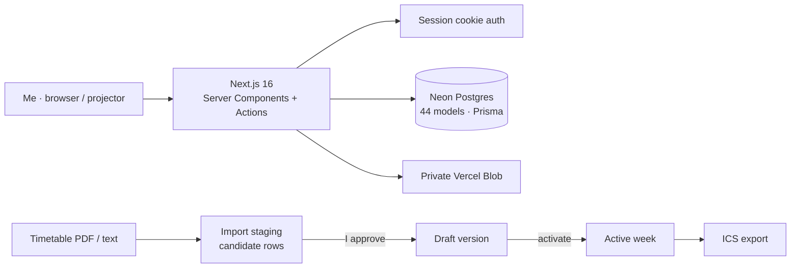

# Student Workspace

**Case study (personal project).** A private academic operating system I built for myself for my postgraduate management programme. It holds subjects, a versioned timetable, assignments, exams, files, notes and group work in one place, with no analytics, no telemetry and no outbound email.

> The source is private because it's connected to my own academic records.
> I'm happy to give a live walkthrough in an interview.

| | |
|---|---|
| **Role** | Designer, engineer and user |
| **Status** | Live on Vercel |
| **Stack** | Next.js 16 · React 19 · TypeScript · Prisma · Neon Postgres · Vercel Blob (private) · Zod |
| **Size** | 44-model schema · 35 pages · PDF and DOCX parsing |

---

## Why I built it

Course information arrives scattered across PDFs, timetable sheets, group chats and portals, and it changes week to week. I wanted one place that **never invents facts**, keeps the history of every change, and holds my files privately.

## What I built

### A timetable that's versioned, not hardcoded
- Every class time lives in a `TimetableEntry` inside a `TimetableVersion` for one week. A version is *Draft*, *Active*, *Revised* or *Archived*.
- **Activating a new version automatically moves the previous one to *Revised*,** so the history survives every reschedule.
- **PDF and pasted-text import produces candidate rows for review.** Nothing reaches the schedule until I approve it on screen, and approval only creates a draft, never an active week.
- **Section-aware conflict detection.** When parallel sections share rooms, slots can be tagged per section, and overlaps are only flagged within the same section.
- **ICS calendar export** of active weeks.

### Coursework
- Assignments with milestones, submissions, private and shared notes, and a change log.
- Exam prep plans broken into tasks.
- Groups with members, tasks, comments and message drafts. Nothing is ever sent automatically; drafts are copied out by hand.
- **A "Present" mode** for when the projector is already on: big tap targets and one tap to put a deck on screen.

### Files and privacy
- Uploads are **private on arrival** in a private blob store. There are no public file URLs. Every read goes through an authenticated route that checks ownership or an explicit share.
- **A missing file and someone else's file return the identical response,** so the endpoint can't be used to probe for what exists.
- Private notes are stored in a separate column from shared notes and are never included in a share.
- Visibility changes are written to an audit log. *Export everything as JSON* gives a full backup.
- In-browser previews of PDF and DOCX files, plus full-text search across them.

### Provenance over guesswork
- Faculty contacts were seeded with **no** email, phone or office details, and marked `UNVERIFIED` until I confirm them from an official source. A badge shows that status everywhere the detail appears.
- **Assistant page** (deterministic, no LLM): document search with citations, timetable-conflict detection for the next 30 days, and suggested milestones for an assignment.

---

## Architecture

---

*Built by [Fawas Koya](https://github.com/fawaskoya).*
